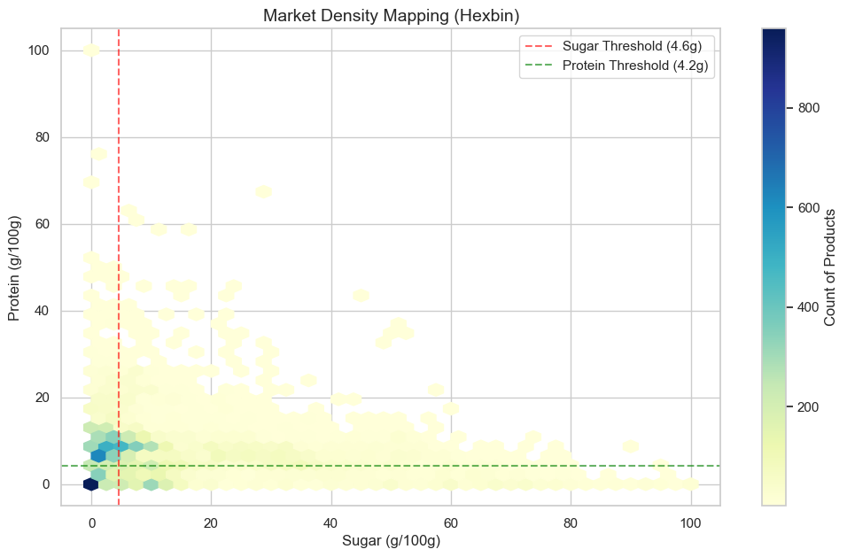
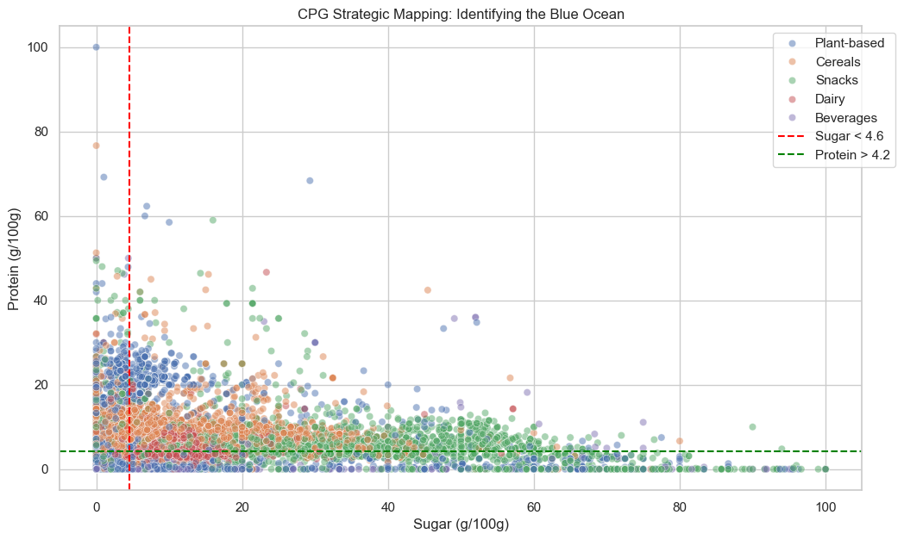

# CPG Market Gap Analysis

An exploratory look at sugar and protein in packaged foods, using Open Food Facts data. I built it in May 2026 as an applicant challenge; the client in the brief was Helix CPG Partners. The question: where might there be room for high-protein, low-sugar products?

- [Notebook](notebook_v2.ipynb)
- [Presentation](https://cpg-market-gap-analysis.onrender.com)
- [Dashboard](https://datastudio.google.com/reporting/34881442-2f4f-48c8-a6eb-f5186f5a4d28)
- [Video walkthrough](https://youtu.be/yhNVJgISP4E)

## Data flow

The raw dataset is over 12 GB. The notebook does not process all of it.

| Step | Rows |
| :--- | ---: |
| Streamed from the start of the file, in chunks of 50,000 | 500,000 |
| Random sample of those rows | 200,000 |
| After dropping missing names or nutrients and impossible values | 42,149 |
| After keeping the mapped categories | 14,017 |

Only five columns are read, and the two numeric columns are downcast to `float32` after loading, to keep memory use low.

## What it shows

- The target area is above 4.2 g protein and below 4.6 g sugar per 100 g.
- Each product gets a nutrient density score: protein / (sugar + 1).
- Counting words in the ingredient lists of products in that area gives flour (4,250), wheat (3,757), acid (3,227), salt (2,849) and water (1,835) as the most frequent.





## Limits and corrections

- **Not a random sample of the whole dataset.** The sample comes from the first 500,000 rows, so it may not represent the market.
- **The 78% salt figure was not a share of products.** It divides the number of times "salt" appears by the number of products, and a product can mention salt more than once.
- **Sodium was not measured.** No sodium or salt column is loaded, so low sodium is an idea to test, not a finding.
- **The target area is not empty,** and the data has no sales or demand figures, so it cannot prove unmet demand.
- The notebook, presentation, dashboard and video predate these corrections and may still state the earlier claims.

## Run it

```bash
pip install pandas numpy matplotlib seaborn
```

Open `notebook_v2.ipynb` in Jupyter or VS Code. It streams the data and saves it as `point5mil.csv`.

## License

GNU General Public License v3.0. See [LICENSE](LICENSE).

**Author:** Ryan Nii Akwei Brown
